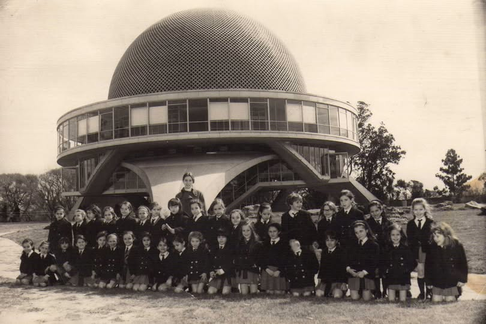
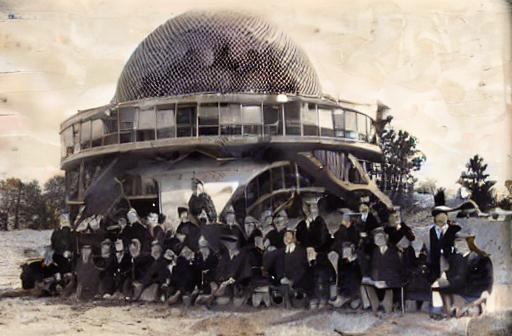
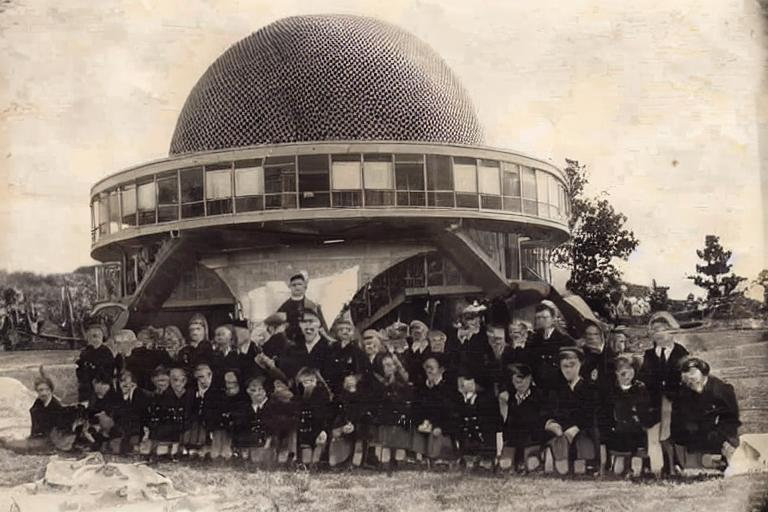
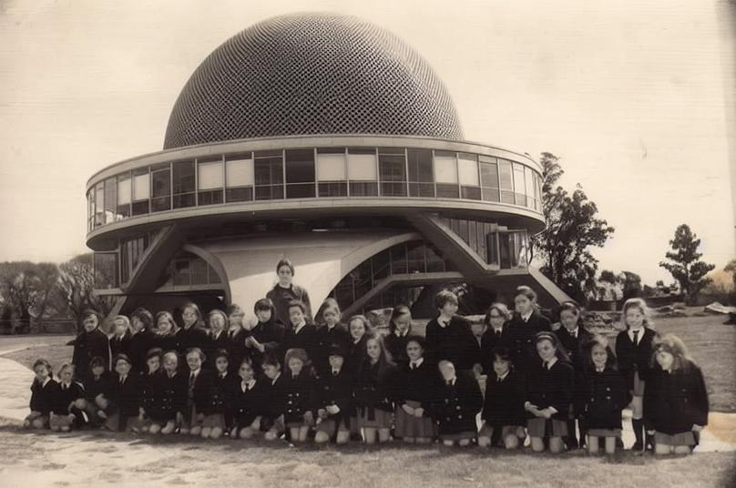
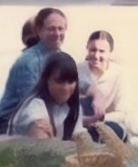

## Tecnicatura Superior en Ciencia de Datos e IA

# Materia: Procesamiento de Imágenes

## Alumna: Victoria Penacca


# Restaurador de Fotos del Centenario Escolar

Desarrollé una herramienta local de restauración asistida por Inteligencia Artificial diseñada para limpiar ruido, grano y desenfoque en fotografías históricas del archivo escolar, priorizando la **integridad documental** y la transparencia sobre qué detalles son originales y cuáles fueron reconstruidos por el modelo.

## Descripción

En el marco de los 100 años de nuestro colegio, exalumnos, docentes y familias están aportando fotografías históricas, escaneos y registros personales. Muchas de estas imágenes presentan desenfoque, grano o baja nitidez. Este sistema se propone mejorarlas visualmente de forma sencilla, verificando que no se altere el contenido histórico (como la cantidad de personas en la escena) y advirtiendo explícitamente qué partes fueron reconstruidas por inteligencia artificial.

## Persona Usuaria

**Nombre**: Elena (64 años)  
**Contexto**: Exalumna y colaboradora de la comisión del Centenario del colegio. Usa computadora y celular de forma cotidiana (navegador, WhatsApp, correo), pero no tiene conocimientos técnicos en IA ni edición de imágenes.  
**Problema**: Tiene fotografías escolares en papel y escaneadas o digitales tomadas con teléfonos antiguos que están borrosas o con ruido y necesita mejorarlas para aportarlas al archivo sin perder fidelidad histórica.  
**Solución**: Una interfaz web simple donde sube la foto, ajusta con un único deslizador cuánto permite modificarla, compara el antes y después, y recibe un aviso claro sobre qué zonas reconstruyó el modelo.


---

## 🛠️ Arquitectura del Proyecto

El agente que usé fue Gemini. Fue fundamental para ayudarme a elegir los modelos en función de mi hardware y para superar algunos obstáculos, como el cambio de los DNS porque mi servidor bloqueaba el acceso al servidor files.pythonhosted.org para descargar los archivos de instalación de algunas librerías de python. 

También me fue guiando para hacer mejoras, ya que las primeras pruebas daban resultados muy malos (ver más abajo).


El código está modularizado en componentes independientes dentro de `src/`:

* **`app.py`**: Interfaz web local construida con **Gradio**. Permite subir fotografías o probar casos del archivo, ajustar la intensidad de restauración y visualizar comparaciones lado a lado.

* **`src/diffusion.py`**: Motor principal de restauración. Combina **Stable Diffusion 1.5** (`stable-diffusion-v1-5/stable-diffusion-v1-5`) con **ControlNet Tile** (`lllyasviel/control_v11f1e_sd15_tile`) y un *scheduler* `DPMSolverMultistepScheduler` para reducir ruido y mejorar nitidez respetando la estructura original. Incluye escalado adaptativo (512px–896px) y *attention slicing* para funcionar en CPU sin desbordar la memoria RAM.

* **`src/analysis.py`**: Módulo de verificación de contenido basado en el detector de objetos **RT-DETR** (`PekingU/rtdetr_r50vd`). Compara la cantidad de personas y elementos reconocidos antes y después de la restauración para alertar si el modelo generativo inventó o eliminó sujetos. 
Esto es fundamental en el proyecto porque la mayoría de las fotos son de personas, por lo que la eliminación no es admisible a menos que sea buscada.

* **`src/honesty.py`**: Módulo de transparencia histórica:
  * Genera una **línea base clásica** mediante filtro bilateral (`scikit-image`) para contrastar un método matemático tradicional contra la IA generativa.
  * Calcula un **mapa de diferencias píxel a píxel** (resaltado en rojo) y el porcentaje promedio de intervención del modelo.
  * Emite un aviso claro sobre qué elementos son reales y cuáles son reconstrucciones plausibles no verificables.


## Qué es real y qué es inventado. Bitácora de Iteraciones Experimentales (Prueba y Error)


Durante las pruebas con fotografías reales del archivo escolar, el *pipeline* de restauración atravesó cuatro etapas de ajuste fino frente a dos casos extremos:
1. **Caso A (`1roAzul.jpg`):** Fotografía grupal amplia con más de 30 alumnas frente al Planetario, con buena nitidez base pero rostros diminutos.
2. **Caso B (`Mrs. Angelica.jpg`):** Recorte de retrato de muy baja resolución ($\approx 145 \times 175\text{ px}$) con fuerte desenfoque y pixelado.


Caso A



### Iteración 1: Stable Diffusion 1.5 puro (`img2img`, $512\text{ px}$, `strength=0.25`)
* **Configuración:** Se aplicó difusión estándar en CPU con *attention slicing* sobre `1roAzul.jpg` escalada a $512\text{ px}$.
* **Resultado observado (`fallo_sin_controlnet.jpg`):** Fallo severo. La estructura arquitectónica del Planetario se distorsionó y los rostros de las alumnas se convirtieron en manchas abstractas.
* **Diagnóstico técnico:** Al reducir una foto grupal a $512\text{ px}$, cada rostro quedó reducido a $\approx 8 \times 8\text{ px}$. El *Autoencoder (VAE)* de Stable Diffusion 1.5 comprime espacialmente la imagen por un factor de $8\times$, eliminando por completo la información facial en ese tamaño.

La primera iteración entregó una foto mucho peor que la original con todos los rostros deformados. Consultada Gemini explicó que el problema era el factor de compresión.



### Iteración 2: Incorporación de ControlNet Tile (`lllyasviel/control_v11f1e_sd15_tile`, $768\text{ px}$)
* **Configuración:** Se reemplazó el *pipeline* estándar por `StableDiffusionControlNetImg2ImgPipeline` con **ControlNet Tile** (`conditioning_scale=0.95`) y se aumentó la resolución máxima a $768\text{ px}$ para anclar los bordes originales.
* **Resultado observado (`fallo2.jpg`):** La cúpula y los ventanales del Planetario recuperaron firmeza geométrica, pero los rostros pequeños continuaron presentando deformaciones respecto a la foto original.
* **Diagnóstico técnico:** Incluso con anclaje estructural, el espacio latente de SD 1.5 no logra reconstruir rasgos faciales diminutos en fotos grupales cuando la imagen original ya posee nitidez aceptable.

La segunda iteración entregó una foto mejor, pero aún peor que la original ya que los rostros seguían deformados. Consultada Gemini explicó que el problema era que los rostros eran muy pequeños y bastante aceptables en el original.


### Iteración 3: Scheduler DPM++ y Mezcla Adaptativa (`strength=0.16`)
* **Configuración:** Se incorporó `DPMSolverMultistepScheduler` (con sigmas Karras), se elevó el límite superior a $896\text{ px}$ y se implementó una mezcla controlada (*blending*) entre una base filtrada sin compresión latente (`denoise_bilateral`) y la salida de difusión (`prueba_fiel.jpg`).
* **Resultado observado:** Se preservó la identidad general en `1roAzul.jpg`, pero al probar el mismo ajuste sobre el recorte chico `Mrs. Angelica.jpg` (`prueba_angelica.jpg`), el resultado seguía pixelado y borroso.
* **Diagnóstico técnico:** La función `Image.thumbnail()` solo reducía imágenes grandes pero no escalaba recortes chicos. `Mrs. Angelica.jpg` ingresó al modelo a $\approx 144 \times 168\text{ px}$ (apenas $18 \times 21$ celdas en el espacio latente del VAE), impidiendo cualquier reconstrucción de detalle.

La tercera iteración entregó una foto mejor, pero seguía siendo mejor la original por lo que pasé a probar otra foto en la que los rostros se veían más grandes. Pero la foto no mejoraba mucho. Según Gemini el problema era la escala chica de esta foto, que era un recorte de otra más grande. Entonces ajustó la preparación de la imagen y también inlcuimos un deslizador interactivo en Gradio para que se pueda ir experimentando y elegir si finalmente la foto es mejor con o sin intervención.


Caso B




### Iteración 4: Escalado Mínimo ($512\text{ px}$) + ControlNet Tile + Unsharp Mask
* **Configuración:** Se modificó `preparar_imagen()` para asegurar un piso mínimo de **$512\text{ px}$** mediante interpolación Lanczos antes de entrar al VAE, permitiendo que ControlNet Tile operara como restaurador de detalle, acompañado de un realce final con `UnsharpMask` y un deslizador interactivo en Gradio (`0.10` a `0.50`).
* **Resultado observado (`prueba_angelica2.jpg` y `prueba_angelica3.jpg`):** Se eliminó el pixelado manteniendo fieles los rasgos de las tres personas en `strength=0.28`. Al forzar `strength=0.40`, se observó el umbral exacto donde el modelo comienza a sintetizar ojos y texturas inexistentes en el original.


---

## Aprendizajes Clave y Conclusiones

1. **La IA generativa no "recupera" información perdida, la sintetiza:** En fotografías grupales con rostros diminutos o recortes muy degradados, los modelos de difusión completan vacíos con detalles estadísticamente plausibles pero no reales y a veces degradando la visibilidad.
2. **Importancia de la resolución de entrada:** El factor de compresión $8\times$ del VAE exige preprocesar los recortes pequeños (escalado mínimo a $512\text{ px}$) antes de la inferencia para evitar pérdida total de rasgos.
3. **Control humano y auditoría transparente:** Exponer el control de intensidad en la interfaz junto con el conteo automático de **RT-DETR** y el **mapa de diferencias en rojo** empodera a la usuaria final (Elena) para decidir cuándo una restauración aporta legibilidad y cuándo conviene conservar el original intacto.

---

## 🚀 Instalación y Ejecución Local

Este proyecto utiliza **`uv`** para la gestión reproducible de dependencias y entornos virtuales en Python.

1. **Clonar el repositorio:**
   ```bash
   git clone [https://github.com/vpenacca-pixel/centenario-restaurador.git](https://github.com/vpenacca-pixel/centenario-restaurador.git)
   cd centenario-restaurador